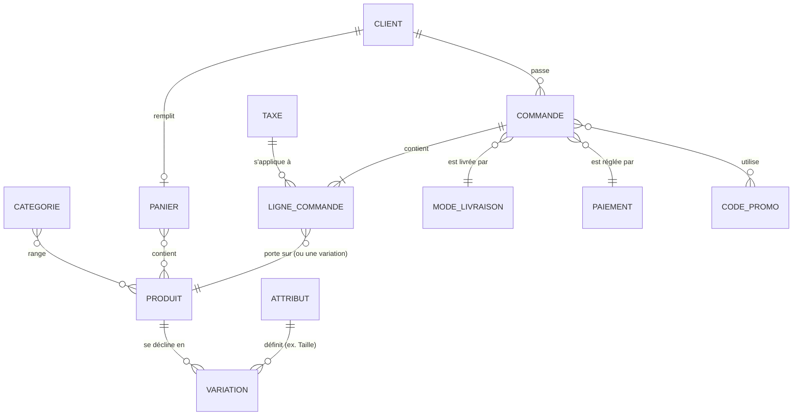
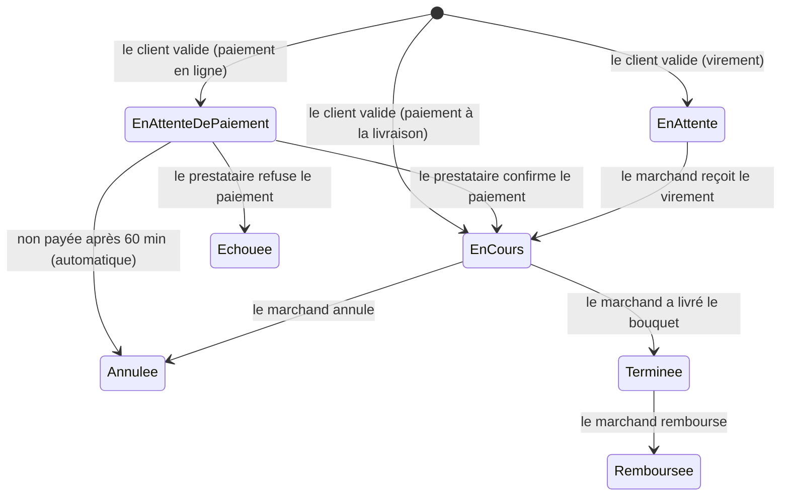

# Note de cadrage — Atelier Pivoine

> Fleuriste de quartier fictif, Paris 11e. WordPress 6.8 + WooCommerce 10.7, lancé avec Docker.

## 1. Ce que le CMS fait à notre place (Strapi + Flutter → WordPress + WooCommerce)
*Responsable : Molka Ferchichi*

| Besoin | Avant (Strapi + Flutter) | Maintenant (WordPress + WooCommerce) |
|---|---|---|
| Catalogue | Types de contenu à modéliser à la main (produit, catégorie, prix, stock) | Produits, catégories, attributs, variations et stock fournis, saisis dans l'admin |
| Panier | État à gérer dans l'application Flutter, perdu si l'app se ferme | Panier côté serveur (session `wp_woocommerce_sessions`), conservé pour un client connecté |
| Commande | Contrôleur à écrire : calcul du total, création de la commande, mise à jour du stock | Tunnel de commande complet, stock décrémenté automatiquement, statuts de commande |
| TVA, livraison, codes promo | À coder (règles de calcul, zones, conditions) | Réglages : taux de TVA, zones et modes de livraison, codes promo avec restrictions |
| Paiement | Intégration du prestataire à écrire et à sécuriser | Moyens de paiement prêts (virement, paiement à la livraison, extension Stripe) |
| Comptes clients | Authentification Strapi + écrans Flutter | Inscription, connexion, « Mon compte », historique des commandes |
| E-mails | Rien par défaut | E-mails transactionnels (commande reçue, en cours, terminée…) |
| Back-office | Admin Strapi générique, sans notion de commerce | Admin orienté commerce : commandes, clients, rapports |
| API | Routes REST générées, à protéger nous-mêmes | Store API publique (panier, commande) et API REST v3 protégée par clés |

**Deux limites que nous avons rencontrées**
1. **Dépendance aux versions.** WooCommerce 11 exige WordPress 7 ; notre image Docker est en WordPress 6.8, nous avons donc dû figer WooCommerce en 10.7.0. Chaque mise à jour du cœur, du thème ou d'une extension peut casser la boutique et doit être testée.
2. **Un modèle générique, pas un modèle métier.** Les besoins d'un fleuriste (date de livraison, créneau, message sur la carte, retrait à l'atelier) n'existent pas : il a fallu les ajouter en PHP par des *hooks* (`inc/boutique.php`, environ 680 lignes). Les produits sont stockés en clé/valeur (`wp_postmeta`), ce qui oblige WooCommerce à maintenir des tables de recherche (`wp_wc_product_meta_lookup`) pour rester rapide.

## 2. Le modèle de données
*Responsable : Molka Ferchichi*

| Objet | Où il est stocké dans WordPress |
|---|---|
| Produit | `wp_posts` (type `product`) + `wp_postmeta` (prix `_price`, UGS `_sku`, stock `_stock`) + `wp_wc_product_meta_lookup` |
| Variation | `wp_posts` (type `product_variation`, rattachée au produit par `post_parent`) + `wp_postmeta` |
| Catégorie | `wp_terms` + `wp_term_taxonomy` (taxonomie `product_cat`) + `wp_term_relationships` |
| Attribut | `wp_woocommerce_attribute_taxonomies` ; ses valeurs (Petit, Moyen, Généreux) sont des termes de la taxonomie `pa_taille` |
| Client | `wp_users` + `wp_usermeta` (adresses), `wp_wc_customer_lookup` pour les rapports |
| Panier | `wp_woocommerce_sessions` ; panier persistant d'un client connecté dans `wp_usermeta` |
| Commande | `wp_wc_orders`, `wp_wc_order_addresses`, `wp_wc_orders_meta` (stockage HPOS, activé sur notre boutique) |
| Ligne de commande | `wp_woocommerce_order_items` + `wp_woocommerce_order_itemmeta` (quantité, total, produit) |
| Taxe | `wp_woocommerce_tax_rates` + `wp_woocommerce_tax_rate_locations` |
| Mode de livraison | `wp_woocommerce_shipping_zones`, `…_zone_locations`, `…_zone_methods` ; réglages de chaque mode dans `wp_options` |
| Paiement | Réglages du moyen de paiement dans `wp_options` ; moyen utilisé et n° de transaction sur la commande (`wp_wc_orders`) |
| Code promo | `wp_posts` (type `shop_coupon`) + `wp_postmeta` (montant, minimum, expiration) |

## 3. Le cycle de vie d'une commande
*Responsable : Molka Ferchichi*

| Statut | Qui le déclenche | Effet sur le stock |
|---|---|---|
| En attente de paiement | Le client, avec un paiement en ligne | Stock **réservé** (`wp_wc_reserved_stock`), pas encore retiré |
| En attente | Le client, en choisissant le virement | Stock **retiré** |
| En cours | Le prestataire (paiement accepté), le marchand (virement reçu) ou le client (paiement à la livraison) | Stock **retiré** s'il ne l'était pas déjà |
| Terminée | Le marchand, une fois le bouquet livré | Aucun changement |
| Échouée | Le prestataire de paiement | Stock non retiré |
| Annulée | Le marchand, ou WooCommerce après 60 min sans paiement | Stock **remis** |
| Remboursée | Le marchand | Stock remis seulement si « Remettre en stock » est coché |

**Observé sur nos commandes test** : payée à la livraison, la n° 37 est passée directement « En cours » et « Petit mot » est passé de 20 à 19 en stock ; payées par virement (n° 66 à 68), les commandes restent « En attente » jusqu'à ce que le marchand confirme le virement ; payée par carte Stripe (mode test), la commande passe « En cours » dès que Stripe accepte le paiement. Les 60 minutes viennent du réglage « Retenir le stock ».

## 4. Notre arbitrage : WooCommerce ou sur-mesure ?
*Responsable : Molka Ferchichi*

**Pour Atelier Pivoine, nous choisissons WooCommerce.**

1. **Délai.** En une semaine : 12 produits (variations, promotion datée), panier, commande, comptes et e-mails. Notre code se limite à environ 1 600 lignes (`theme/atelier-pivoine-blocs/inc/`, `scripts/`, `mu-plugins/`) ; tout le reste vient du CMS. Au projet précédent, panier et commande étaient entièrement à écrire.
2. **Coût.** WordPress, WooCommerce et l'extension Stripe sont gratuits (licence GPL) : **deux extensions** seulement. Un hébergement mutualisé PHP + MySQL suffit. Stripe facture à la transaction (tarif public sur stripe.com/fr/pricing) ; en sur-mesure, il faudrait en plus payer le développement et la sécurisation du paiement.
3. **Maintenance et dépendances.** Les correctifs de sécurité sont écrits par les équipes de WordPress et WooCommerce ; nous les appliquons après test (5 mises à jour proposées dès l'installation). En contrepartie, nous dépendons de leurs versions : WooCommerce 11 et Stripe 10.8 exigent un WordPress plus récent que notre 6.8, d'où des versions figées (10.7.0 et 10.7.2).

**Quand le sur-mesure deviendrait pertinent** : abonnements hebdomadaires, tournées de livraison optimisées, plusieurs boutiques à stock partagé, ou une application mobile au cœur de l'activité ; les *hooks* coûteraient alors plus cher qu'une API dédiée. Pour un fleuriste de quartier, ce n'est pas le cas.
