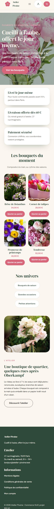
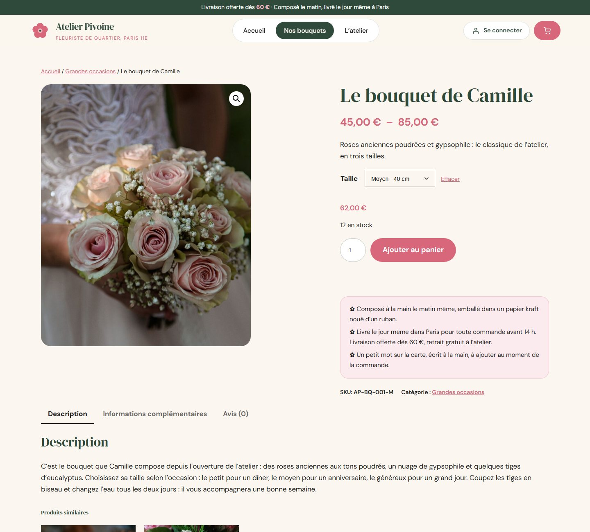
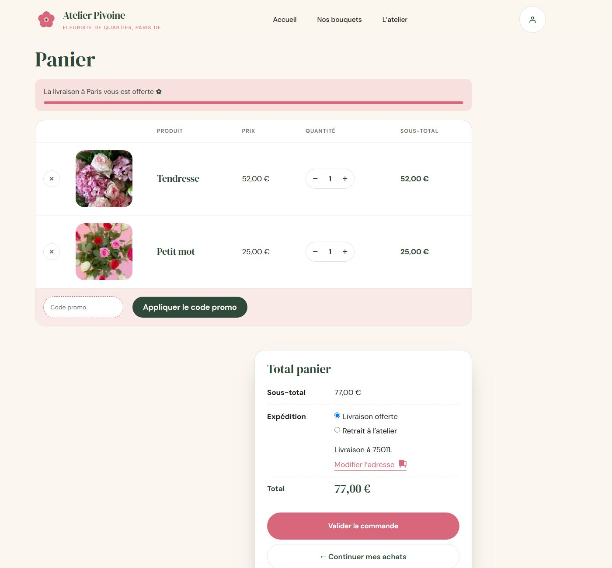
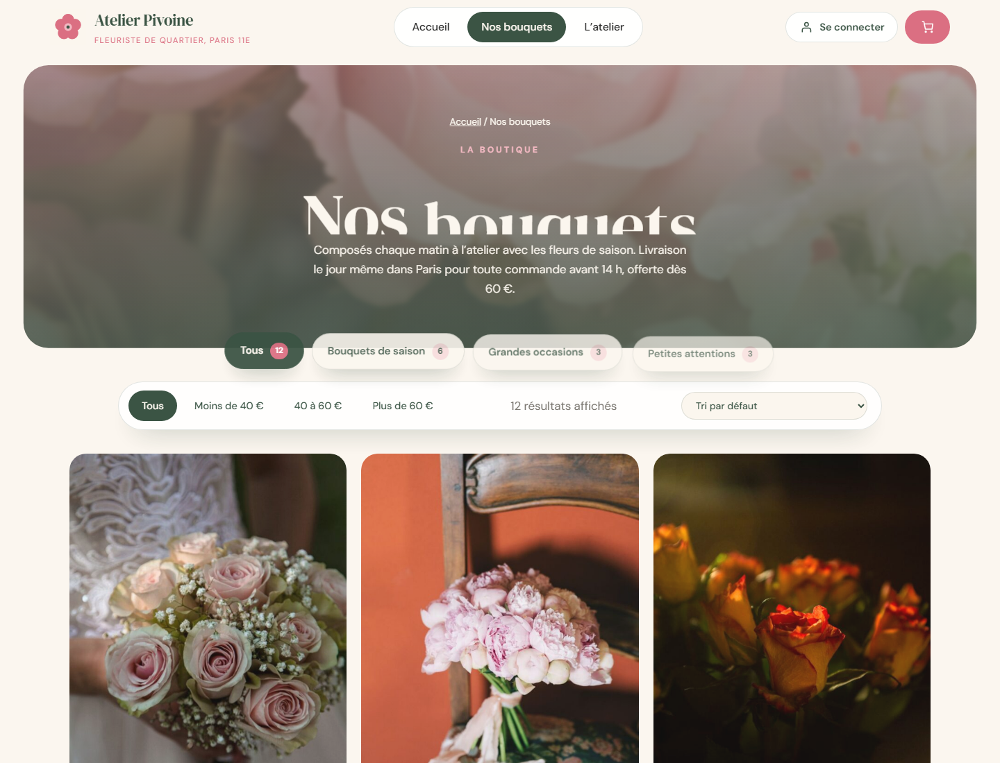
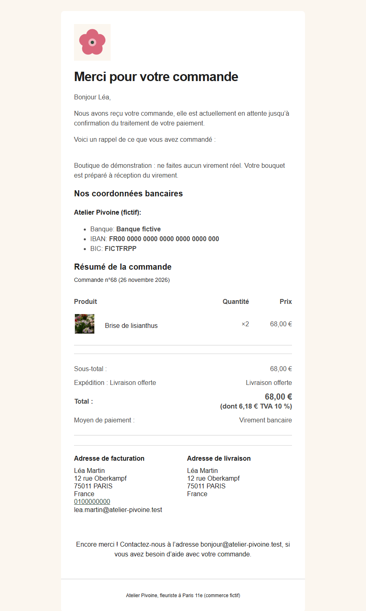
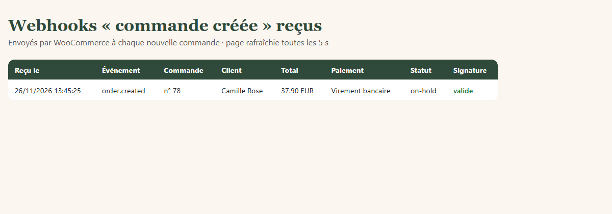

# Atelier Pivoine — boutique en ligne


Fleuriste de quartier fictif, Paris 11e. WordPress 6.8 + WooCommerce 10.7, thème en blocs enfant de Twenty Twenty-Five.
Équipe : Molka Ferchichi, Marietou, Prénom C, Prénom D.
Commerce, noms, adresses et e-mails **fictifs** : aucune donnée personnelle réelle.

## Relancer la boutique (5 minutes)

Il faut Docker Desktop et Git Bash (ou un terminal Linux / macOS).

```bash
git clone https://github.com/molka-svg/fleuriste-atelier-pivoine
cd fleuriste-atelier-pivoine
cp .env.example .env          # puis remplir les valeurs (mots de passe et secret inventés)
bash scripts/restauration.sh  # importe sauvegardes/base-demo.sql + medias-demo.tar.gz
bash scripts/stripe-test.sh   # facultatif : paiement par carte, avec ses propres clés de test Stripe
```

| Quoi | Adresse |
|---|---|
| Boutique | http://localhost:8080 |
| Administration | http://localhost:8080/wp-admin (identifiants transmis à part, jamais dans Git) |
| E-mails envoyés (Mailpit) | http://localhost:8025 |
| Webhooks reçus (bonus) | http://localhost:8090 |

Partir de zéro plutôt que d'une sauvegarde : installer WordPress sur http://localhost:8080, puis lancer dans l'ordre
`scripts/configurer-boutique.php`, `scripts/catalogue.php` et `scripts/vendre.php`
(`docker compose cp scripts/xxx.php wordpress:/tmp/` puis `docker compose exec -u www-data wordpress php /tmp/xxx.php`).

## Où vérifier chaque exigence

| Partie | Exigence | Où la voir |
|---|---|---|
| — | Charte (nom, logo, couleurs, polices, vouvoiement) | [charte/CHARTE.md](charte/CHARTE.md) |
| 1 | Note de cadrage | [NOTE.md](NOTE.md) |
| 2 | Thème en blocs (sources) | [theme/atelier-pivoine-blocs](theme/atelier-pivoine-blocs) (Apparence > Éditeur) |
| 2 | Thème exporté (Éditeur > Outils > Exporter) | [theme/export/atelier-pivoine-blocs.zip](theme/export/atelier-pivoine-blocs.zip) |
| — | Première version (thème classique PHP, avant le passage aux blocs) | [theme/atelier-pivoine](theme/atelier-pivoine) : conservé pour l'historique, **non activé** |
| 3 | 12 bouquets, 3 catégories, variable, promo, rupture | [scripts/catalogue.php](scripts/catalogue.php) · admin > Produits |
| 4 | TVA, livraison, paiements, code promo, pages légales, e-mails | [scripts/vendre.php](scripts/vendre.php) · Stripe : [scripts/stripe-test.sh](scripts/stripe-test.sh) et [docs/paiement-carte-stripe.md](docs/paiement-carte-stripe.md) |
| 5 | Collection Postman | [api/boutique.postman_collection.json](api/boutique.postman_collection.json) |
| 6 | Sécurité | [.env.example](.env.example) · [mu-plugins/securite.php](mu-plugins/securite.php) · section ci-dessous |
| 7 | Sauvegarde et restauration Docker | [scripts/sauvegarde.sh](scripts/sauvegarde.sh) · [scripts/restauration.sh](scripts/restauration.sh) · [docker-compose.yml](docker-compose.yml) |
| Bonus | Mini-extension maison (41 lignes) | [extensions/bandeau-livraison](extensions/bandeau-livraison/bandeau-livraison.php) |
| Bonus | Webhook « commande créée » reçu et affiché | [webhook/index.php](webhook/index.php) · [scripts/webhook.php](scripts/webhook.php) · [mu-plugins/webhooks.php](mu-plugins/webhooks.php) |

## Captures

| Accueil | Vue téléphone (390 px) |
|---|---|
|  |  |

**Fiche produit** : « Le bouquet de Camille », produit variable en 3 tailles


**Panier** : boutons − / +, barre « livraison offerte dès 60 € », code promo


**Commande** : formulaire en 3 étapes, livraison ou retrait, date et créneau, message sur la carte


**Boutique restaurée dans Docker** (MariaDB, http://localhost:8080) à partir de `sauvegardes/` avec `scripts/restauration.sh`


**E-mail de confirmation de commande** reçu dans Mailpit : logo, couleurs de la charte, TVA à 10 % détaillée


## Vendre (partie 4)

- **TVA** : prix saisis et affichés TTC. Taux normal 20 % et taux réduit 10 % (classe « Taux réduit fleurs ») appliqué aux bouquets : les fleurs coupées non transformées relèvent du taux de 10 % en France.
- **Livraison** : zone Paris (coursier 8,90 €, offert dès 60 €) et zone France (standard 48 h à 6,90 €, express 24 h à 12,90 €, standard offerte dès 60 €), retrait gratuit à l'atelier partout.
- **Paiements de test** : virement bancaire (RIB fictif, commande « En attente ») et carte bancaire Stripe en mode test (carte `4242 4242 4242 4242`, commande « En cours » dès que Stripe accepte). Les clés sont saisies avec `scripts/stripe-test.sh`, qui les envoie directement dans la base : elles ne sont ni dans Git ni dans la sauvegarde de démonstration.
- **Code promo** `BIENVENUE10` : −10 %, dès 40 € d'achat, jusqu'au 31/12/2026, une fois par client, non cumulable.
- **Pages légales** : Mentions légales, Conditions générales de vente, Politique de confidentialité ; case « J'ai lu et j'accepte les conditions générales de vente » obligatoire au moment de la commande.
- **E-mails** : couleurs et logo de la charte, reçus dans Mailpit (`mu-plugins/mailpit.php` envoie les e-mails de WordPress vers Mailpit).

## API : en-têtes envoyés et reçus (partie 5)

Collection [api/boutique.postman_collection.json](api/boutique.postman_collection.json), variable `baseUrl` (par défaut `http://localhost:8080`), 5 requêtes, 14 tests. À lancer dans l'ordre (Postman > Run collection) ou en ligne de commande :
`docker run --rm -v "$PWD/api:/etc/newman" postman/newman:6-alpine run boutique.postman_collection.json --env-var baseUrl=http://host.docker.internal:8080`

1. **GET /wc/store/v1/products** : on envoie seulement `Accept: application/json`, sans authentification puisque le catalogue est public ; la réponse revient en `Content-Type: application/json` avec les prix en centimes (`currency_minor_unit: 2`, donc `4500` = 45,00 €).
2. **GET /wc/store/v1/cart** : on n'envoie aucun jeton ; le serveur crée un panier et renvoie son identifiant dans l'en-tête de réponse `Cart-Token` (un jeton signé), que le test mémorise dans la variable `cartToken`.
3. **POST /wc/store/v1/cart/add-item** : on envoie `Content-Type: application/json` et `Cart-Token: {{cartToken}}` pour désigner ce panier sans cookie ; la réponse est `201 Created` et renvoie de nouveau `Cart-Token`.
4. **POST /wc/store/v1/checkout** : on envoie le même `Cart-Token` avec les adresses et `payment_method: bacs` ; la réponse donne `order_id` et le statut `on-hold`, et la commande apparaît dans WooCommerce > Commandes (avec ses 2 e-mails dans Mailpit).
5. **GET /wc/v3/orders sans clé** : on n'envoie ni en-tête `Authorization` ni clé `ck_…/cs_…` ; la réponse est `401 Unauthorized` (`woocommerce_rest_cannot_view`). C'est une bonne nouvelle : les commandes contiennent noms, adresses et téléphones, seuls un administrateur connecté ou une clé API créée dans WooCommerce peuvent les lire.

## Sécurité : 5 mesures et risques couverts (partie 6)

| Mesure | Risque couvert | État |
|---|---|---|
| Mots de passe dans `.env`, ignoré par Git ; `.env.example` ne contient que les noms. Clés Stripe saisies dans l'admin uniquement, retirées de la sauvegarde de démonstration par `sauvegarde.sh demo` | Fuite des mots de passe de la base ou des clés de paiement en publiant le dépôt | En place |
| Liste des utilisateurs masquée dans l'API REST (`/wp-json/wp/v2/users` → 404) et `/?author=1` redirigé ([mu-plugins/securite.php](mu-plugins/securite.php)) | Un robot récupère les identifiants de connexion puis devine les mots de passe | En place |
| XML-RPC coupé, version de WordPress masquée, modification du code PHP désactivée dans l'admin (`DISALLOW_FILE_EDIT`) | Attaque par force brute en masse via XML-RPC ; ciblage d'une faille connue ; un compte volé qui installe un programme malveillant | En place |
| Compte administrateur renommé (pas « admin »), double authentification et limitation des tentatives de connexion (extension Two Factor + Limit Login Attempts Reloaded), rôles au plus juste (le fleuriste en « Gestionnaire de boutique », pas administrateur) | Prise de contrôle de l'administration par mot de passe deviné ou volé | Prévu pour la production |
| HTTPS (certificat Let's Encrypt de l'hébergeur) et mises à jour automatiques de sécurité, testées d'abord sur une copie restaurée avec Docker | Mot de passe ou données client interceptés sur le réseau ; faille connue d'une extension non corrigée | Prévu pour la production |

Vérification : `git grep -nE "ck_|cs_|password|DB_PASSWORD"` ne renvoie que des noms de variables (`${DB_PASSWORD}`), des champs de formulaire et des noms d'options WordPress, aucune valeur secrète.

## Sauvegarde : cron, stockage distant, UpdraftPlus (partie 7)

`bash scripts/sauvegarde.sh` exporte la base (`wp db export`) et archive les médias (`wp-content/uploads`) dans `sauvegardes/base-AAAA-MM-JJ.sql` et `medias-AAAA-MM-JJ.tar.gz`. `bash scripts/sauvegarde.sh demo` produit la sauvegarde de démonstration versionnée, sans les clés de paiement.

**Chaque nuit sur un serveur**, une tâche cron (`crontab -e`) :

```cron
# 3 h du matin : sauvegarde, copie hors du serveur, on garde 14 jours en local
0 3 * * * cd /srv/atelier-pivoine && bash scripts/sauvegarde.sh >> /var/log/sauvegarde-pivoine.log 2>&1 && rclone copy sauvegardes/ stockage-distant:atelier-pivoine/ && find sauvegardes -name '*-20*' -mtime +14 -delete
```

Les fichiers partent **sur un autre support que le disque du site** : un stockage objet (Backblaze B2, Scaleway, S3) via `rclone`, avec une règle de conservation (30 jours, puis une par mois). Si le serveur brûle ou est piraté, la sauvegarde reste intacte. Une sauvegarde n'est valable qu'une fois restaurée : on rejoue `restauration.sh` chaque mois sur une machine de test.

**UpdraftPlus 1.26**, installé et lancé sur notre boutique le 26/11/2026 : une sauvegarde complète en 19 secondes, découpée en 6 archives (base 0,2 Mo, extensions 28 Mo, thèmes 21 Mo, médias 7 Mo, mu-plugins, autres), soit environ 60 Mo contre 7,5 Mo pour notre script, qui ne garde que la base et les médias puisque le reste se réinstalle depuis Git. Sans stockage distant configuré, UpdraftPlus a tout rangé dans `wp-content/updraft`, **sur le même disque que le site** : exactement ce qu'il faut éviter. En plus de notre script, il planifie les sauvegardes depuis l'admin sans toucher au serveur, les envoie directement vers un stockage distant (Google Drive, Dropbox, S3) et restaure en un clic depuis l'admin. En moins : il vit **dans** WordPress. Si le site ne démarre plus (base corrompue, extension cassée, serveur perdu), on ne peut plus ouvrir l'admin pour restaurer. Notre script, lui, ne dépend que de Docker et de la ligne de commande. Il ne sauvegarde pas non plus la configuration du serveur, et la version gratuite n'offre ni migration ni sauvegarde incrémentale.

## Déploiement chez un hébergeur cPanel

Chez un hébergeur mutualisé, on refait les mêmes étapes à la main. Dans **cPanel > Bases de données MySQL**, on crée une base, un utilisateur et un mot de passe. Dans **phpMyAdmin**, on importe `base-demo.sql`. Avec le **gestionnaire de fichiers** ou en **SFTP** (FileZilla), on envoie WordPress, `wp-content/themes/atelier-pivoine-blocs`, `wp-content/mu-plugins` et le contenu de `medias-demo.tar.gz` dans `wp-content/uploads`, puis on installe WooCommerce. On renseigne `wp-config.php` (nom de la base, utilisateur, mot de passe, hôte, clés de salage neuves) : c'est l'équivalent de notre `.env`. On change l'adresse avec `wp search-replace` si l'hébergeur fournit WP-CLI en SSH, sinon avec l'extension Better Search Replace, jamais dans le fichier SQL. Enfin, on active le **certificat HTTPS** gratuit (AutoSSL / Let's Encrypt) dans cPanel et on force le HTTPS. **Quand choisir quoi** : cPanel pour un petit commerce sans développeur, pour quelques euros par mois, avec sauvegardes et certificat gérés par l'hébergeur, mais tout se fait à la main et se rejoue mal. Docker quand on veut un environnement identique partout (poste, test, production), une restauration scriptée et testable, et une équipe capable de maintenir un serveur (VPS).

## Bonus réalisés

**Mini-extension maison** : [extensions/bandeau-livraison/bandeau-livraison.php](extensions/bandeau-livraison/bandeau-livraison.php), 41 lignes, activée dans Extensions. Un bandeau vert en haut de chaque page annonce « Livraison offerte dès 60 € », puis « Plus que 15,00 € pour la livraison offerte » quand le panier n'y est pas encore, et « La livraison vous est offerte ! » au-delà. Le seuil se change sans toucher au code (filtre `bandeau_livraison_seuil`) et les couleurs viennent des Styles du thème.

**Webhook « commande créée »** : WooCommerce envoie chaque nouvelle commande, signée, au petit service `webhook` du `docker-compose.yml` ([webhook/index.php](webhook/index.php), PHP sans framework), qui vérifie la signature `X-WC-Webhook-Signature` (HMAC-SHA256 avec le secret `WEBHOOK_SECRET` du `.env`) et affiche les commandes reçues sur http://localhost:8090. Le webhook est créé par `scripts/webhook.php`, lancé automatiquement par `restauration.sh`. Deux réglages ont été nécessaires dans Docker ([mu-plugins/webhooks.php](mu-plugins/webhooks.php)) : livrer tout de suite (WordPress ne peut pas s'appeler lui-même sur localhost:8080 pour vider sa file d'attente) et autoriser l'adresse interne `webhook`. Le secret n'est jamais dans Git : `sauvegarde.sh demo` exporte la table des webhooks sans ses lignes.



## Qui a fait quoi

| Partie du sujet | Responsable | Contributions |
|---|---|---|
| Charte | Molka Ferchichi | Charte graphique, logo |
| 1 · Note de cadrage | Molka Ferchichi | Les 4 parties de `NOTE.md`, schéma du modèle de données, cycle de vie observé sur nos commandes |
| 2 · Design en blocs | Molka Ferchichi · Marietou | Molka : thème en blocs, Styles, en-tête, pied de page, accueil, fiche produit, boutique, Mon compte, export, captures. Marietou : premier thème classique et design de l'atelier |
| 3 · Catalogue | Molka Ferchichi | 12 bouquets, galeries, produit variable, promotion, stock |
| 4 · Vendre | Marietou · Molka Ferchichi | Marietou : TVA, livraison, virement, pages légales, e-mails. Molka : panier, commande en 3 étapes, code promo, carte Stripe en mode test |
| 5 · API | Molka Ferchichi | Collection Postman (5 requêtes, 14 tests), explication des en-têtes |
| 6 · Git et sécurité | Molka Ferchichi | Dépôt sans secret, 5 mesures dont 3 en place (`mu-plugins/securite.php`) |
| 7 · Déployer | Molka Ferchichi · Marietou | Molka : `docker-compose.yml` MariaDB, scripts de sauvegarde et de restauration, sauvegarde de démonstration, UpdraftPlus, cron, cPanel. Marietou : premier Docker, restauration rejouée sur sa machine |
| Bonus | Molka Ferchichi | Mini-extension « livraison offerte », webhook signé |

**Molka Ferchichi**
- **Panier** : boutons − / +, barre « livraison offerte dès 60 € », bouton « Continuer mes achats », panier vide soigné, code promo et bloc total aux couleurs de la charte, vue téléphone.
- **Commande** : formulaire en 3 étapes (coordonnées, livraison ou retrait, bouquet), cartes livraison / retrait, créneau en boutons, récapitulatif avec photos ; paiement par carte Stripe en mode test (`scripts/stripe-test.sh`, clés jamais écrites dans un fichier).
- **Thème en blocs** `theme/atelier-pivoine-blocs` (enfant de Twenty Twenty-Five) : couleurs et polices dans Styles, en-tête et pied de page en éléments de modèle, accueil en blocs, fiche produit et boutique retouchées, page Mon compte, export depuis l'éditeur.
- **Catalogue** `scripts/catalogue.php` : 12 bouquets, 3 catégories, un bouquet en 3 tailles, une promotion datée, une rupture, UGS, galeries, photos Pexels recadrées au même format ; code promo BIENVENUE10 ; boutique en français.
- **Note de cadrage** `NOTE.md` (les 4 parties) et **README** avec les 8 captures.
- **API** : collection Postman `api/boutique.postman_collection.json`, 5 requêtes et 14 tests automatiques.
- **Sécurité** : dépôt sans secret, `.env.example`, liste des utilisateurs masquée, XML-RPC coupé, édition du code désactivée.
- **Déploiement** : `docker-compose.yml` (MariaDB, WordPress, WP-CLI), `scripts/sauvegarde.sh` (retire les clés de paiement et le secret du webhook de la sauvegarde de démonstration), `scripts/restauration.sh` (boutique reconstruite en moins de 2 minutes), UpdraftPlus.
- **Bonus** : mini-extension `extensions/bandeau-livraison` et webhook « commande créée » signé et affiché.

**Marietou**
- Thème `theme/atelier-pivoine`, panier latéral, connexion et compte client ; design de l'atelier porté dans le thème en blocs.
- Docker, script `scripts/configurer-boutique.php`, maquette cliquable du parcours client.
- Partie 4 `scripts/vendre.php` : TVA, zones de livraison, virement, pages légales, e-mails et Mailpit.
- Restauration rejouée sur sa machine à partir du dépôt.

## Sources des images

Photos libres de droits (Unsplash et Pexels), recadrées au même format :
- photos du thème : [theme/atelier-pivoine-blocs/images/CREDITS.md](theme/atelier-pivoine-blocs/images/CREDITS.md) et [theme/atelier-pivoine/images/CREDITS.md](theme/atelier-pivoine/images/CREDITS.md) ;
- photos des 12 bouquets et des galeries : [theme/atelier-pivoine-blocs/images/CREDITS.md](theme/atelier-pivoine-blocs/images/CREDITS.md).

## Ce que nous ferions autrement

- **Partir du thème en blocs dès le premier jour.** Nous avons d'abord construit un thème classique en PHP, puis tout reporté dans le thème en blocs : deux fois le même travail.
- **Mettre les réglages dans des scripts dès le début.** Langue, code promo et TVA ont d'abord été réglés à la main dans l'admin de chacun ; tant qu'ils n'étaient pas dans `scripts/` ou dans une sauvegarde, nos boutiques locales n'étaient pas identiques.
- **Choisir la base de production (MariaDB) dès le départ.** Passer de MySQL 8.4 à MariaDB pour la restauration a demandé un export depuis le conteneur MySQL : le client MariaDB ne gère pas l'authentification par défaut de MySQL 8.4.
- **Garder les fonctions métier dans une petite extension** plutôt que dans le thème : la date, le créneau et le message sur la carte disparaissent aujourd'hui si on change de thème.
