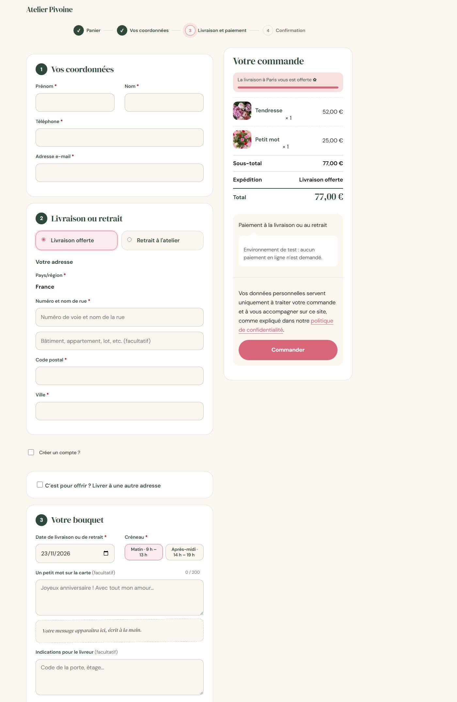

# Atelier Pivoine — boutique en ligne


Fleuriste de quartier fictif, Paris 11e. Équipe : Prénom A, Prénom B, Prénom C, Prénom D.
Commerce, noms, adresses et e-mails **fictifs**.

> 🚧 README en cours de rédaction.

## Où vérifier chaque exigence
| Exigence | Où la voir |
|---|---|
| Charte | charte/CHARTE.md |
| Note de cadrage | NOTE.md |
| Thème exporté | theme/atelier-pivoine |
| Collection Postman | api/boutique.postman_collection.json |
| Restauration | scripts/restauration.sh + capture Docker ci-dessous |

## Captures

| Accueil | Vue téléphone (390 px) |
|---|---|
|  |  |

**Fiche produit** : « Le bouquet de Camille », produit variable en 3 tailles


**Panier** : boutons − / +, barre « livraison offerte dès 60 € », code promo


**Commande** : formulaire en 3 étapes, livraison ou retrait, date et créneau, message sur la carte


À venir : boutique restaurée dans Docker · e-mail de commande dans Mailpit · collection Postman

## Relancer la boutique
```bash
git clone https://github.com/molka-svg/fleuriste-atelier-pivoine
cd fleuriste-atelier-pivoine
cp .env.example .env        # puis remplir les 4 valeurs (mots de passe inventés)
bash scripts/restauration.sh
# ouvrir http://localhost:8080
```

## Choix de design
## Sources des images
Photos du thème : voir [theme/atelier-pivoine/images/CREDITS.md](theme/atelier-pivoine/images/CREDITS.md) (Unsplash et Pexels).
Photos des 12 bouquets (dont les 4 ajoutés et les galeries) : voir [theme/atelier-pivoine-blocs/images/CREDITS.md](theme/atelier-pivoine-blocs/images/CREDITS.md).

| Fichier | Auteur | Source (URL) |
|---|---|---|

## API : en-têtes envoyés et reçus
## Sécurité : 5 mesures et risques couverts
## Sauvegarde : cron, stockage distant, UpdraftPlus
## Déploiement chez un hébergeur cPanel
## Bonus réalisés
## Ce que nous ferions autrement
